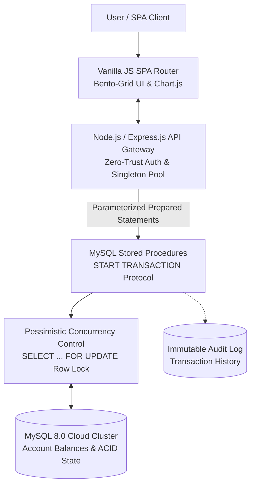
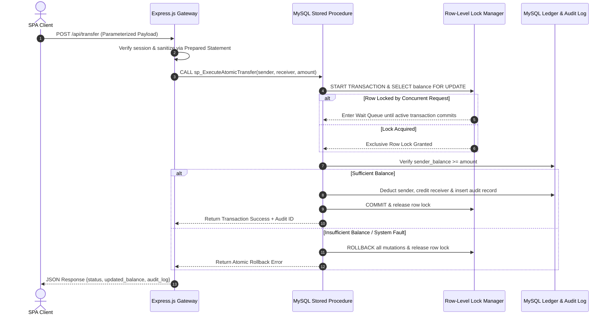

<div align="center">

# HKS Bank & Co. | Enterprise Banking Architecture

### Enterprise-grade **transactional banking engine**: Node.js Express API + ACID Compliance + Pessimistic Concurrency Control + Row-Level Locking

[](https://hks-bank-co.onrender.com/)
[](https://nodejs.org/)
[](https://expressjs.com/)
[](https://www.mysql.com/)
[](https://developer.mozilla.org/)
[](https://www.chartjs.org/)
[](https://www.docker.com/)
[](LICENSE)

**Client Action -> SPA Router -> Express.js API Gateway -> MySQL Stored Procedures -> FOR UPDATE Row-Level Locks -> ACID Committed Ledger**

<h4>
  <a href="https://hks-bank-co.onrender.com/">View Live Deployment</a>
  <span> · </span>
  <a href="#quick-start-local">Quick Start</a>
  <span> · </span>
  <a href="#architecture">Architecture</a>
</h4>

</div>

---

A high-fidelity, interactive **Single Page Application (SPA)** banking portal engineered to simulate high-frequency, secure financial transactions. It eliminates multi-user race conditions and double-spending vulnerabilities by offloading core transfer ledger mutations to atomic **MySQL Stored Procedures** wrapped in strict **`START TRANSACTION`** protocols and **Pessimistic Concurrency Control (`FOR UPDATE` row-level locking)**.

## Table of Contents
1. [The Engineering Problem & Solution](#the-engineering-problem--solution)
2. [Features](#features)
3. [Architecture](#architecture)
4. [Transaction Concurrency Lifecycle](#transaction-concurrency-lifecycle)
5. [Tech Stack](#tech-stack)
6. [Project Structure](#project-structure)
7. [Quick Start (Local)](#quick-start-local)
8. [Key API Endpoints](#key-api-endpoints)
9. [Pessimistic Locking & ACID Deep-Dive](#pessimistic-locking--acid-deep-dive)
10. [Environment Variables](#environment-variables)
11. [Roadmap](#roadmap)
12. [Troubleshooting](#troubleshooting)
13. [Contributing & License](#contributing--license)

---

## The Engineering Problem & Solution

> **The Problem:** In a high-frequency multi-user environment, two concurrent requests might attempt to withdraw or transfer funds from the exact same account at the exact same millisecond. Without strict database-level locking, this leads to **Race Conditions**—where the database reads a stale balance before the previous transaction finishes, resulting in "double-spending" and corrupted ledger states.

**The Transactional Solution:**
1. **The API Gateway Layer (`Node.js / Express.js`):** Acts as a non-blocking ingress router utilizing a frozen Singleton connection pool running parameterized **Prepared Statements** over TLS/SSL to neutralize SQL Injection (`SQLi`) vectors.
2. **The Concurrency Layer (`FOR UPDATE` Row-Level Locking):** Enforces **Pessimistic Concurrency Control** inside MySQL so competing transactions targeting the same account row are serialized in a deterministic wait queue.
3. **The Atomic Ledger Layer (`MySQL Stored Procedures`):** Offloads critical balance mutations from the application layer directly into `START TRANSACTION` and `ROLLBACK` database protocols, guaranteeing all-or-nothing **ACID compliance**.

---

## Features

| Feature | Description |
|---|---|
| **Atomic Fund Transfers** | Leverages **MySQL Stored Procedures** to ensure multi-step transfers (Deduct -> Add -> Audit Log) complete as a single unit or roll back entirely |
| **Pessimistic Row Locking** | Implements **`SELECT ... FOR UPDATE` row-level locking** to queue concurrent requests and eliminate double-spending race conditions |
| **Singleton DB Pool** | Secures data interactions via a frozen creational **Singleton Connection Pool** with parameterized **Prepared Statements** (`SQLi` protection) |
| **Decoupled SPA Router** | Custom **Vanilla JavaScript (ES6+)** client-side router managing view state and navigation without page reloads |
| **Bento-Grid Dashboard** | Real-time financial telemetry UI rendering live balance visualizations via **Chart.js** and immutable audit logs |
| **Zero-Trust Isolation** | RESTful API layer enforcing strict user-scoped data isolation to prevent horizontal privilege escalation vulnerabilities |
| **Cloud-Native Hygiene** | Decoupled environment configuration ready for containerized and cloud-managed MySQL deployments |

---

## Architecture



<details>
<summary>ASCII version</summary>

```text
          ┌──────────────────────────────────────────────────────────┐
          │             Bento-Grid SPA Dashboard (Client)            │
          │      Vanilla JS Router · Chart.js · Live Audit View      │
          └────────────────────────────┬─────────────────────────────┘
                                       │
                        Zero-Trust REST API (JSON/TLS)
                                       │
          ┌────────────────────────────▼─────────────────────────────┐
          │              Node.js / Express.js API Gateway            │
          │   Frozen Singleton Connection Pool · Prepared Statements │
          └────────────────────────────┬─────────────────────────────┘
                                       │
                         Atomic Stored Procedure Call
                                       │
          ┌────────────────────────────▼─────────────────────────────┐
          │               MySQL 8.0 Transactional Engine             │
          │     START TRANSACTION · Pessimistic Row-Level Locking    │
          └──────┬─────────────────────┬──────────────────────┬──────┘
                 │                     │                      │
         1. Acquire Lock        2. Mutate Ledger       3. Append Trace
                 │                     │                      │
          ┌──────▼──────┐    ┌─────────▼───────────┐   ┌──────▼──────┐
          │ FOR UPDATE  │    │  Account Balances   │   │  Immutable  │
          │  Row Queue  │    │ (Deduct / Credit)   │   │  Audit Log  │
          └─────────────┘    └─────────────────────┘   └─────────────┘
```
</details>

---

## Transaction Concurrency Lifecycle



<details>
<summary>Text version</summary>

```text
Client (SPA) -> POST /api/transfer
  │
  ├─ 1. Express.js Gateway: Validates session & binds parameters via Prepared Statements
  ├─ 2. Singleton Pool: Dispatches call to MySQL Stored Procedure
  ├─ 3. MySQL Transactional Engine:
  │      ├─ Initiates atomic block via START TRANSACTION
  │      ├─ Acquires exclusive row lock on sender account (SELECT ... FOR UPDATE)
  │      ├─ Serializes any competing concurrent requests into a Wait state
  │      ├─ Checks invariant (balance >= transfer_amount)
  │      ├─ Executes atomic Deduct -> Credit -> Audit Log insertion
  │      └─ Issues COMMIT (or full ROLLBACK on failure) and releases row lock
  └─ 4. Returns real-time JSON state update to Bento-Grid Dashboard without page reload
```
</details>

---

## Tech Stack

| Layer | Technology |
|---|---|
| **API Gateway** | Node.js, Express.js, Asynchronous Non-Blocking REST Architecture |
| **Database Engine** | MySQL 8.0 (Cloud-Managed Cluster, Relational Schema) |
| **Concurrency & ACID** | MySQL Stored Procedures, `START TRANSACTION` / `ROLLBACK`, `FOR UPDATE` Pessimistic Locks |
| **Data Security** | Frozen Singleton Connection Pool, Parameterized Prepared Statements (`SQLi` Defense), TLS/SSL |
| **Frontend Architecture** | Vanilla JavaScript (ES6+), Custom Decoupled SPA Router, HTML5, Modern CSS3 (Bento-Grid) |
| **Telemetry & Visuals** | Chart.js (Real-Time Financial Analytics & Balance Visualization) |
| **Infrastructure** | Render Cloud Deployment, Environment Variable Isolation |

---

## Project Structure

```text
HKS-Bank-Co/
├── public/                     # Static frontend assets
│   ├── index.html              # Single Page Application root shell
│   ├── script.js               # Frontend application logic & state manager
│   └── style.css               # Bento-grid layout & enterprise styling
├── .gitignore
├── db.js                       # MySQL database connection pool configuration
├── demo.gif                    # Architectural and application demo recording
├── package-lock.json
├── package.json
├── README.md                   # Enterprise architecture documentation
├── schema.sql                  # Relational tables, indexes & Stored Procedures
└── server.js                   # Express.js server entry point
```

---

## Quick Start (Local)

### Option A: Standard Local Setup

```bash
# 1. Clone the repository
git clone [https://github.com/itsmeharshkumarsingh/HKS-Bank-Co.git](https://github.com/itsmeharshkumarsingh/HKS-Bank-Co.git)
cd HKS-Bank-Co

# 2. Install Node.js dependencies
npm install

# 3. Configure environment variables
cp .env.example .env
# Edit .env with your DB_HOST, DB_USER, DB_PASS, and DB_NAME

# 4. Initialize MySQL schema and Stored Procedures
mysql -u root -p < database/schema.sql
mysql -u root -p < database/procedures.sql

# 5. Launch the enterprise gateway
npm start
```

| Service | Local URL | Description |
|---|---|---|
| **SPA Banking Portal** | `http://localhost:3000` | Interactive Bento-Grid dashboard, SPA router & Chart.js |
| **Express API Gateway** | `http://localhost:3000/api` | REST endpoints for transfers, balances & audit logs |
| **MySQL Cluster** | `localhost:3306` | ACID-compliant relational ledger & Stored Procedures |

### Option B: Testing Concurrent Race Conditions

```bash
# Fire two simultaneous transfer requests against the same account row
curl -X POST http://localhost:3000/api/transfer \
  -H "Content-Type: application/json" \
  -d '{"senderId": 101, "receiverId": 102, "amount": 600}' & \
curl -X POST http://localhost:3000/api/transfer \
  -H "Content-Type: application/json" \
  -d '{"senderId": 101, "receiverId": 103, "amount": 600}'
```

---

## Key API Endpoints

| Service | Method | Path | Description |
|---|---|---|---|
| **Auth** | `POST` | `/api/auth/login` | Authenticate user session and initialize isolated state |
| **Accounts** | `GET` | `/api/account/dashboard` | Fetch user-isolated balance, telemetry & Chart.js series |
| **Transfers** | `POST` | `/api/transfer` | Trigger atomic MySQL Stored Procedure with `FOR UPDATE` lock |
| **Ledger** | `GET` | `/api/transactions/audit` | Query immutable audit log for the authenticated account |
| **Health** | `GET` | `/api/health` | Verify Singleton MySQL connection pool & gateway readiness |

---

## Pessimistic Locking & ACID Deep-Dive

Instead of relying on naive application-level balance checks (`SELECT` in Node.js followed by `UPDATE`), every transfer passes through a **4-stage database-enforced concurrency pipeline**:

| Stage | Mechanism | Engineering Impact |
|---|---|---|
| **1. Row Lock Acquisition** | `SELECT balance FROM accounts WHERE id = ? FOR UPDATE` | Locks the specific sender row; competing transactions enter a serialized wait queue |
| **2. Invariant Verification** | Evaluates `balance >= transfer_amount` inside the locked scope | Prevents stale reads and eliminates multi-user double-spending race conditions |
| **3. Atomic Mutation** | Executes Debit, Credit, and Audit Log `INSERT` inside `START TRANSACTION` | Guarantees all three ledger mutations succeed together or `ROLLBACK` completely |
| **4. Lock Release & Commit** | Issues `COMMIT` and flushes durability logs to disk | Releases the row lock for the next queued request while preserving ACID state |

---

## Environment Variables

Create a `.env` file in the root directory before launching:

| Variable | Description |
|---|---|
| `PORT` | Express API Gateway listening port (default: `3000`) |
| `DB_HOST` | MySQL cluster hostname or IP address (`localhost` or cloud endpoint) |
| `DB_PORT` | MySQL database port (default: `3306`) |
| `DB_USER` | MySQL authentication username |
| `DB_PASS` | MySQL authentication password |
| `DB_NAME` | Target MySQL database schema (`hks_bank_ledger`) |
| `SESSION_SECRET` | Cryptographic secret for securing isolated user sessions |

---

## Roadmap

- [x] Atomic fund transfers via MySQL Stored Procedures (`START TRANSACTION` / `ROLLBACK`)
- [x] Pessimistic concurrency control using `SELECT ... FOR UPDATE` row-level locking
- [x] Frozen Singleton database pool with parameterized Prepared Statements (`SQLi` prevention)
- [x] Decoupled Vanilla JS Single Page Application (SPA) with Bento-Grid Chart.js telemetry
- [ ] Deadlock detection & deterministic account-ID lock ordering for bidirectional transfers
- [ ] Redis read-through cache with write-invalidation for sub-millisecond audit log queries
- [ ] Automated k6 load-testing suite simulating 1,000+ concurrent transfer race conditions

---

## Troubleshooting

| Problem | Fix |
|---|---|
| `ER_LOCK_WAIT_TIMEOUT` during transfers | Ensure no manual MySQL client session is holding an uncommitted `FOR UPDATE` transaction |
| `ECONNREFUSED 127.0.0.1:3306` | Verify your MySQL server is running and `.env` credentials match your local/cloud instance |
| Stored Procedure not found (`ER_SP_DOES_NOT_EXIST`) | Re-run `mysql -u root -p < database/procedures.sql` to register the atomic transfer routines |
| SSL/TLS handshake error on cloud MySQL | Ensure `ssl: { rejectUnauthorized: true }` is configured inside `config/db.js` for cloud clusters |

---

## Contributing & License

Engineered as an enterprise backend architecture showcase for SDE technical interviews. While external pull requests are restricted to preserve architectural baselines, feedback and issue reports are always welcome:

1. Fork the repository
2. Create your feature branch (`git checkout -b feature/Optimization`)
3. Commit your changes (`git commit -m 'Optimize SQL row-lock indexing'`)
4. Push to the branch (`git push origin feature/Optimization`)
5. Open a Pull Request

Distributed under the **MIT License**. See [`LICENSE`](LICENSE) for more information.

<div align="center">

### If you find this transactional banking architecture useful, give the repository a star.

</div>